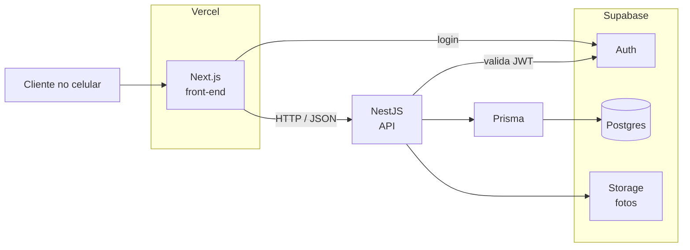

# Visão geral da arquitetura

Decisão de stack registrada em [[ADR-001-stack]].

- O front fala com a API; a regra de negócio fica toda no NestJS.
- O Supabase serve apenas Postgres, autenticação e arquivos. A Data API pública fica desligada.

> [!todo] Preencher: onde a API NestJS será hospedada (spike pendente). O diagrama mostra só o front dentro da Vercel.

## Ver também

- [[visao]]
