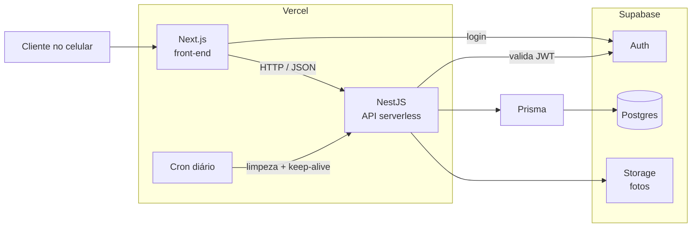

# Visão geral da arquitetura

Decisão de stack registrada em [[ADR-001-stack]].

- O front fala com a API; a regra de negócio fica toda no NestJS.
- O Supabase serve apenas Postgres, autenticação e arquivos. A Data API pública fica desligada.

- A API roda como função serverless na Vercel, em projeto separado do front, e o cron diário da plataforma cancela pedidos expirados e mantém o Supabase ativo (ver [[ADR-002-hospedagem-api]]).
- Estrutura do monorepo e camadas: [[ADR-005-monorepo-camadas]].

## Ver também

- [[visao]]
